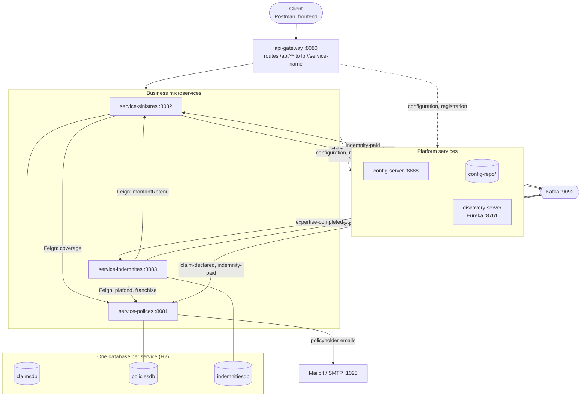
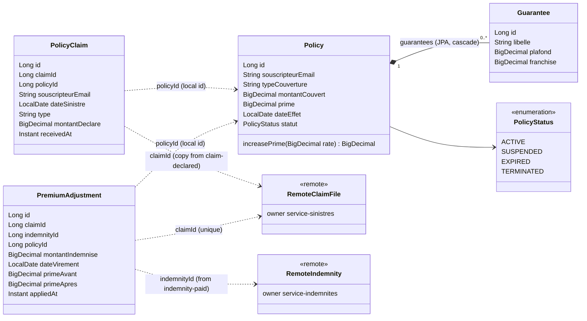
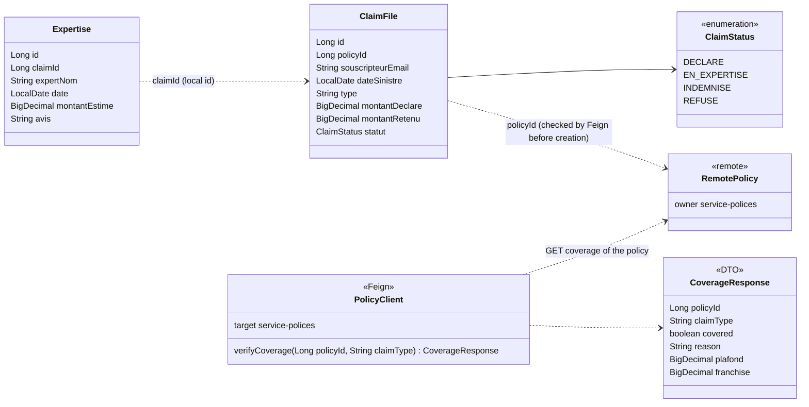
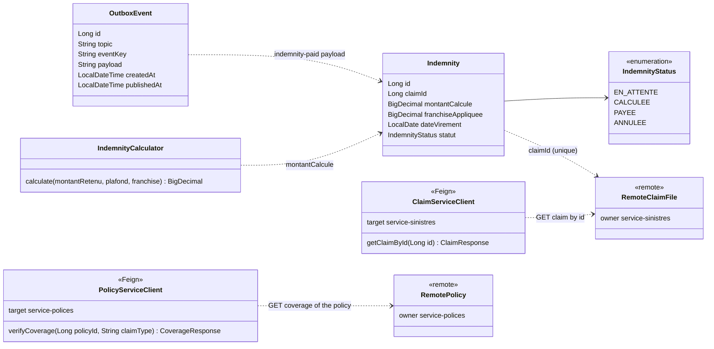
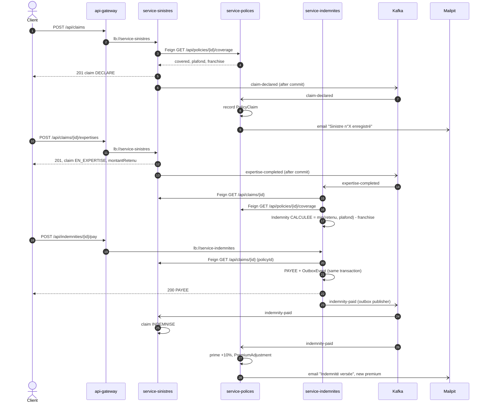

# Architecture

Sinistre-Pro is made of three business microservices, each with its own database, behind an API gateway. They are configured by a config server, find each other through a Eureka registry, call each other with OpenFeign, and exchange events through Kafka.

The diagrams below are written in [Mermaid](https://mermaid.js.org/): GitHub renders them directly, and they live next to the code they describe.

## 1. Overall architecture

| Component | Port | Role |
| --- | --- | --- |
| `api-gateway` | 8080 | Single entry point. Routes `/api/policies/**`, `/api/claims/**` and `/api/indemnities/**` to the services by their Eureka name (`lb://`), load-balanced. |
| `config-server` | 8888 | Serves each application's configuration from [`config-repo/`](../config-repo). |
| `discovery-server` | 8761 | Eureka registry: every application registers as `<name>:<port>`. |
| `service-polices` | 8081 | Policies, guarantees, coverage verification, premium rule, policyholder emails. |
| `service-sinistres` | 8082 | Claim files and expert assessments. |
| `service-indemnites` | 8083 | Indemnity calculation and payment. |
| Kafka | 9092 | Asynchronous events between the services. |
| Mailpit | 1025 / 8025 | Local SMTP server and inbox for the emails. |

## 2. Class diagrams per microservice

Each service owns its tables. **No foreign key ever crosses a service boundary.** Another service's object is referenced only by its id (`policyId`, `claimId`, `indemnityId`). Remote classes appear below as `Remote…` with the `«remote»` stereotype, linked by dashed arrows. [Section 3](#3-how-remote-references-are-managed) explains how each remote reference is checked.

### service-polices

- `Policy` → `Guarantee` is the only real JPA relation in the project: one-to-many, cascade, orphan removal.
- `PolicyClaim` is the policy's **own copy** of a claim, recorded from the `claim-declared` event. Polices never reads the claims database.
- `PremiumAdjustment` records each +10% premium increase applied from `indemnity-paid`. The unique `claimId` makes a resent event harmless.
- DTOs: `PolicyRequest`/`PolicyResponse`, `GuaranteeRequest`/`GuaranteeResponse`, `CoverageVerificationResponse` (the Feign contract), `PolicyClaimResponse`, `PremiumAdjustmentResponse`. Events: `ClaimDeclaredEvent`, `IndemnityPaidEvent`.

### service-sinistres

- Lifecycle: `DECLARE` → (expertise) `EN_EXPERTISE` → (`indemnity-paid`) `INDEMNISE`. `REFUSE` is reserved for refused claims.
- Recording an expertise copies `montantEstime` into `ClaimFile.montantRetenu`, which service-indemnites reads.
- DTOs: `ClaimRequest`/`ClaimResponse` (the Feign contract read by indemnites), `ExpertiseRequest`/`ExpertiseResponse`. Events: `ClaimDeclaredEvent` and `ExpertiseCompletedEvent` (published after commit), `IndemnityPaidEvent` (consumed).

### service-indemnites

- Calculation: `montantCalcule = max(0, min(montantRetenu, plafond) − franchise)`. `montantRetenu` comes from sinistres; `plafond` and `franchise` come from polices.
- `OutboxEvent`: `indemnity-paid` is saved in the same transaction as the payment, and a scheduled publisher sends it to Kafka. Nothing is lost if Kafka is down.
- Both Feign clients are protected by Retry, Circuit Breaker and timeouts (see [`config-repo/service-indemnites.properties`](../config-repo/service-indemnites.properties)).
- DTOs: `IndemnityRequest`/`IndemnityResponse`, `ClaimResponse` and `CoverageResponse` (Feign). Events: `ExpertiseCompletedEvent` (consumed), `IndemnityPaidEvent` (published).

## 3. How remote references are managed

| Reference | Owner of the target | Check | When |
| --- | --- | --- | --- |
| `ClaimFile.policyId` | service-polices | Feign `verifyCoverage`. Unknown policy → 400, not covered → 422, polices unreachable → 503. Nothing is saved unless covered. | Before a claim is created |
| `Indemnity.claimId` (calculation) | service-sinistres | Feign `getClaimById` (unknown claim → 404), then Feign `verifyCoverage` on the claim's policy | Before an indemnity is calculated |
| `Indemnity.claimId` (manual `POST /api/indemnities`) | service-sinistres | **Not checked remotely**, only that the claim has no indemnity yet | — |
| `PolicyClaim.claimId` | service-sinistres | Trusted: comes from the `claim-declared` event of the owner. Unknown `policyId` → skipped. | When the event is consumed |
| `PremiumAdjustment.claimId`, `indemnityId` | sinistres, indemnites | Trusted: comes from the `indemnity-paid` event. Unknown policy → skipped; claim already applied → skipped. | When the event is consumed |
| `IndemnityPaidEvent.claimId` in sinistres | service-sinistres (local) | Claim must exist, belong to the same policy and be `EN_EXPERTISE` | When the event is consumed |

Rules shared by every service:

- **Only ids cross service boundaries**, never JPA relations or another service's tables.
- **Synchronous checks** (Feign) happen before a creation that depends on another service, through the target's Eureka name.
- **Asynchronous copies** (Kafka) keep a local copy of what a service needs, for example the claims recorded on a policy. They are published only after the producer's transaction commits.
- **Consumers are idempotent:** a unique key (`claimId`) or a status check makes a resent event harmless. A message that can never apply is logged and skipped.

## 4. Life of a claim (sequence)

The Postman collection replays this scenario step by step and checks each arrow: folder `04 - Scénario complet` in [`postman/`](../postman).
